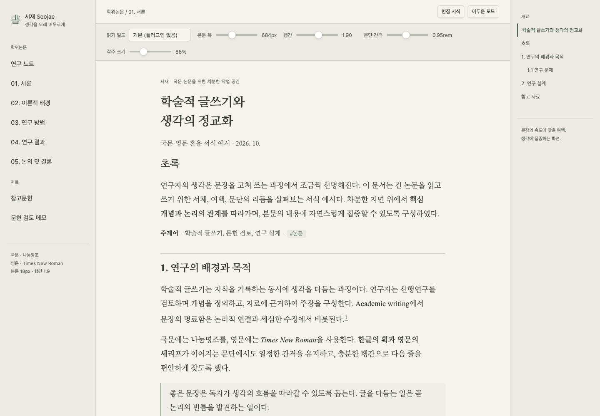
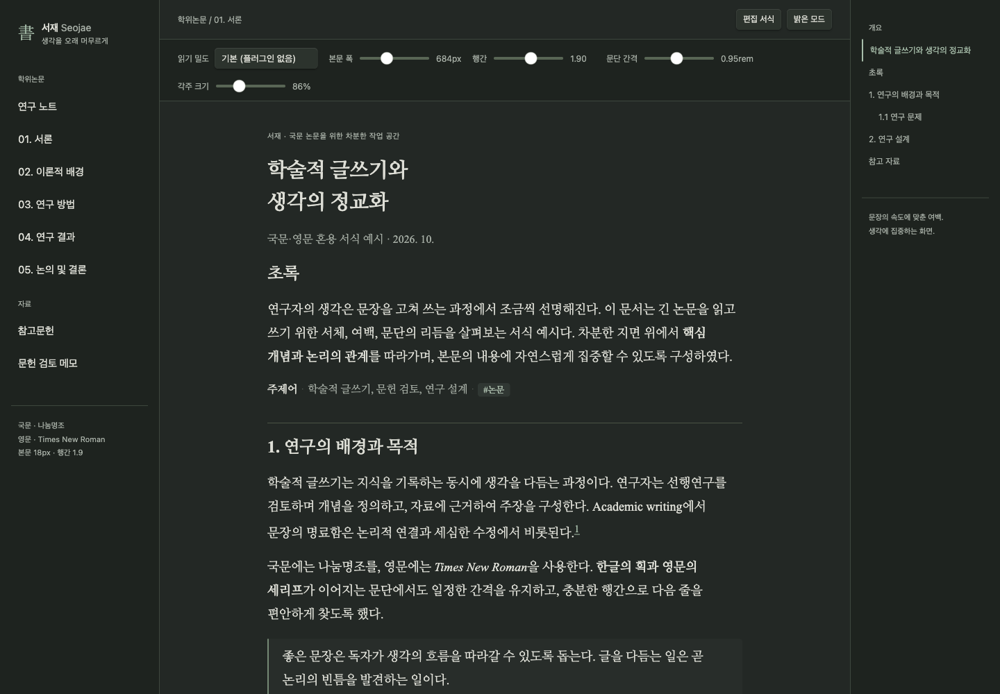

# 서재 · Seojae

A quiet Obsidian theme for Korean academic writing, with warm light colors, a muted dark palette, and bilingual serif typography.

국문 논문을 오래 읽고 쓰기 위한 Obsidian 테마입니다. 영문은 **Times New Roman**, 한글은 **나눔명조**를 우선 사용합니다.



## Features

- Light and dark modes with restrained colors and underlined links.
- Times New Roman for Latin text and Nanum Myeongjo for Korean text when those fonts are installed on the device.
- No bundled fonts or runtime downloads; missing fonts fall back to Noto Serif CJK KR and the device serif font.
- Adjustable reading width, density, paragraph spacing and footnote size through the optional **Style Settings** plugin.
- Reference-note hanging indents in Reading view with `cssclasses: seojae-references`.
- A4-oriented print styling, with an 11pt body and 1.8 line spacing.

No plugin is required. Defaults are a 684px readable width, 1.9 line spacing, 0.95rem paragraph spacing and footnotes at 86% of body size. Obsidian's text-size setting remains available.



These images show a browser preview rendered with the installed Obsidian 1.13.7 base CSS and a fictional sample manuscript. They are not screenshots of a live vault. Native Obsidian interaction, Korean IME input and PDF pagination still need testing.

## Install

Open the [Seojae Community page](https://community.obsidian.md/themes/seojae) and choose **Add to Obsidian**. If the current release is not yet available there, install it manually:

1. Download `theme.css` and `manifest.json` from a [published release](https://github.com/takjakim/obsidian-seojae/releases).
2. Put both files directly inside `<vault>/.obsidian/themes/Seojae/`.
3. Open **Settings → Appearance → Themes** and select **Seojae**. Restart Obsidian if it is not listed.

Turn on **Settings → Editor → Readable line length** to use the theme's reading width. Install the optional **Style Settings** community plugin to adjust the theme controls; the current control labels are Korean.

See the [한국어 사용 안내](GUIDE.ko.md) and [sample notes](examples/) for details. The theme does not check citations or guarantee compliance with a university's thesis formatting rules.

## Fonts and license

Install [Nanum Myeongjo Regular and Bold](https://fonts.google.com/specimen/Nanum+Myeongjo) on every device where you use the theme. Seojae uses locally installed fonts in this order: Times New Roman for Latin text, Nanum Myeongjo (`Nanum Myeongjo` or `나눔명조`) for Korean text, then Noto Serif CJK KR and the device serif fallback. Mobile font availability depends on the operating system.

The theme does not bundle or download fonts, so it works offline once the required fonts are installed. Times New Roman is also not included. The theme CSS is licensed under the [MIT License](LICENSE). The font files bundled with the historical 1.1.0 release remain documented under the [SIL Open Font License 1.1](https://github.com/takjakim/obsidian-seojae/blob/1.1.0/FONT-LICENSE.txt).

## Development

Edit `src/theme.css`, then build and validate with Python 3:

```sh
python3 scripts/build.py
python3 scripts/validate.py
```

The build copies the checked-in source into the release artifact and does not depend on an earlier release artifact. No package installation or font download is required. See [RELEASING.md](RELEASING.md) for versioning, GitHub releases and Community directory submission.

## Verification scope

The recorded 1.1.0 browser preview covered light/dark text contrast, font selection, reading-density presets, narrow layouts, reference styling and print CSS. Version 1.1.1 removes the embedded font data and adds package safeguards; this does not constitute fresh native Obsidian QA. The manifest declares Obsidian 1.10.6 or later, and direct execution on that minimum version and on mobile remains unverified. See [VERIFICATION.md](VERIFICATION.md) for the recorded scope and limitations.

Report reproducible problems with your Obsidian version, operating system, light/dark mode and relevant Style Settings values. Use a minimal sample note without private research material.
